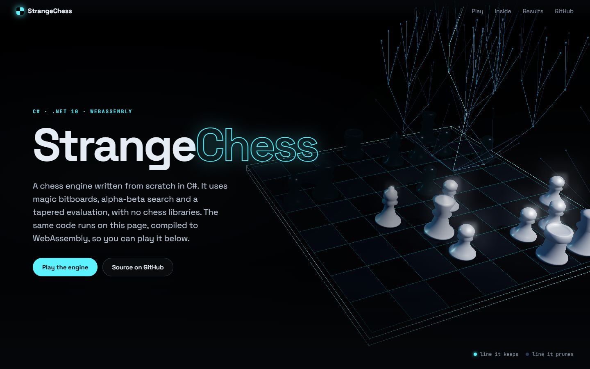
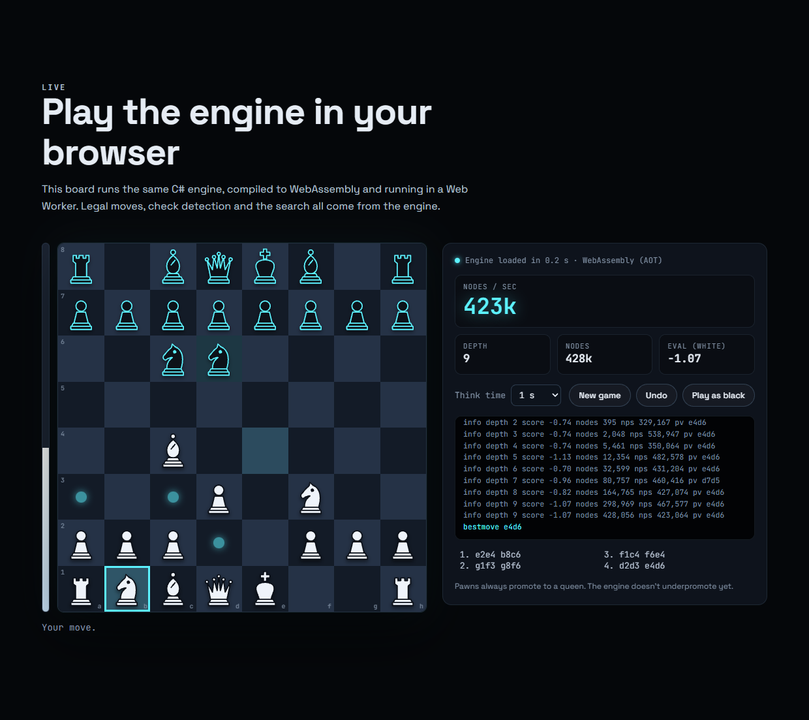
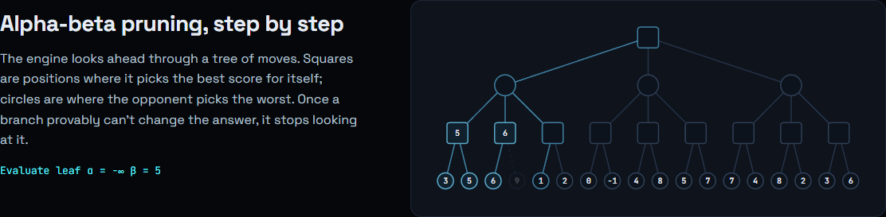
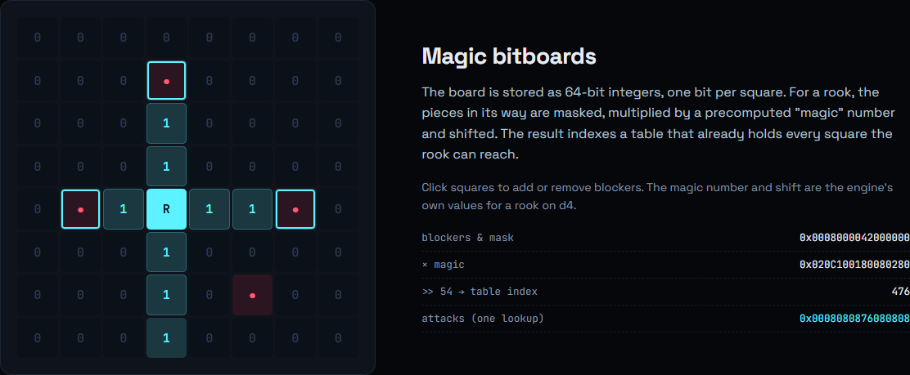
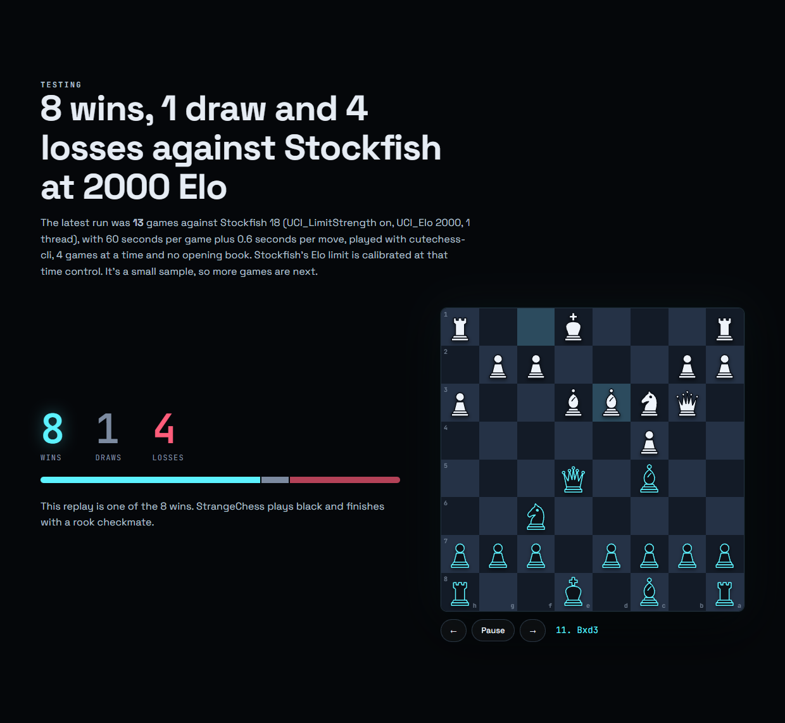
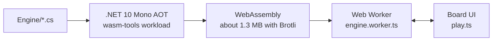

# StrangeChess website

The showcase site for the [StrangeChess](https://github.com/Jayesh-27/StrangeChess) chess engine, live at **[strangechess.vercel.app](https://strangechess.vercel.app)**.

Visitors play the real C# engine in the browser. The engine source is compiled to WebAssembly and runs in a Web Worker, so legal moves, check detection and the search all come from the same code as the console engine on `main`.



## What's on the page

| Section | What it shows |
| --- | --- |
| Hero | A three.js board where search trees grow out of the pieces: bright branches are kept, dim ones pruned |
| Numbers | Perft and search speed (native), live nodes/sec measured in the visitor's browser, transposition table size, lines of C# |
| Play | A board backed by the WebAssembly engine, with a live console of the search (depth, score, nodes, nodes/sec), an eval bar, think time, undo and play as black |
| Inside the engine | An animated alpha-beta pruning tree, an interactive magic-bitboard lookup using the engine's real rook magic for d4, and cards for each search and evaluation technique |
| Build pipeline | How the C# source becomes WebAssembly in the browser |
| Results | The latest logged match against Stockfish 18 limited to 2000 Elo, with a replay of a win |









## How the engine gets into the browser



- `wasm/StrangeChess.Wasm.csproj` links the engine files from `Engine/` (everything except `Program.cs`) instead of copying them, so the site always builds the same source.
- `wasm/EngineExports.cs` is a thin `[JSExport]` bridge: `Init`, `NewGame`, `SetPosition`, `LegalMoves`, `InCheck`, `BoardString` and `Search`.
- `site/src/engine.worker.ts` loads the .NET runtime in a Web Worker and calls `Search` one depth at a time, so the page can show progress after each depth. It sets `globalThis.dotnetSidecar = true` before loading the runtime; without it, .NET treats a worker that has an `onmessage` handler as a thread-pool helper and waits forever.
- The engine exposes three read-only counters for the site (`nodesSearched`, `completedDepth`, `completedScore` in `AI.cs`). Search behaviour is the same as on `main`.

## Repository layout (this branch)

| Path | Contents |
| --- | --- |
| `Engine/` | The C# engine source, shared with `main` |
| `wasm/` | WebAssembly build project, JS bridge and `build.sh` |
| `site/` | Vite + TypeScript + three.js website |
| `site/public/engine/_framework/` | The prebuilt WebAssembly engine, committed because Vercel can't run the .NET SDK |
| `site/scripts/` | `matches.pgn` from cutechess-cli and the script that turns it into `src/data/match.json` |
| `docs/screenshots/` | The images in this README |

## Run locally

Needs Node.js.

```bash
cd site
npm install
npm run dev
```

## Rebuild the engine for the web

Only needed after changing `Engine/`. Needs the .NET 10 SDK and the wasm-tools workload (`dotnet workload install wasm-tools`).

```bash
bash wasm/build.sh
```

The output goes to `site/public/engine/_framework/`. Commit it.

## Update the match results

Run a match with cutechess-cli (see the README on `main`), copy the PGN over `site/scripts/matches.pgn`, then:

```bash
cd site
npm run replay
```

This recounts wins, draws and losses (skipping unfinished games) and picks the shortest checkmate win for the replay. The headline and replay text on the page are generated from that data.

## Deploy

Vercel builds this branch with the **Vite** preset and **Root Directory** `site`; `site/vercel.json` sets the build command, output folder and cache headers. Every push to `site` redeploys.

## Branches

| Branch | Contents |
| --- | --- |
| `main` | The standalone C# engine |
| `site` | This website |
| `EngineInUnity` | The original Unity project |
