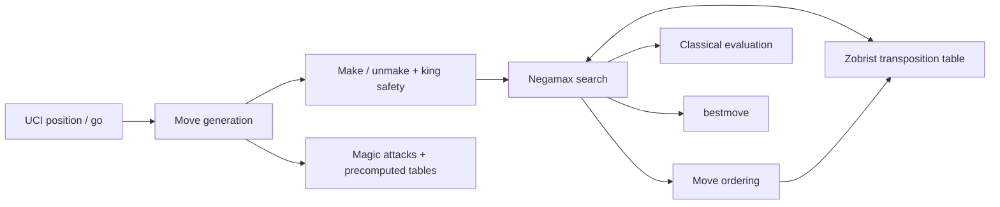

# StrangeChess

A chess engine written from scratch in C# (.NET 10), with no chess libraries. It speaks UCI, so it works with UCI chess GUIs such as cutechess.

**Play it in your browser: [strangechess.vercel.app](https://strangechess.vercel.app)**. The site runs this same engine compiled to WebAssembly.


| Play the engine in your browser | Results against Stockfish 2000 |
| --- | --- |
|  |  |


The website's source is on the [`site`](https://github.com/Jayesh-27/StrangeChess/tree/site) branch.

## Description - Overview
I started this as a hobby project. My first implementation made many mistakes, for example using a mailbox board representation, so I had to rewrite the entire engine while learning and implementing bitboards, magic bitboards, minimax, alpha-beta pruning, negamax, Zobrist hashing, bitwise operations, evaluation design and more.

The engine was first built inside Unity, then decoupled into this standalone console engine. Since it's built from scratch, it can be extended with custom pieces and rules. I used this flexibility in my hackathon project RPG Chess, where I added a custom piece called the Dragon: https://github.com/Jayesh-27/RPG-CHESS.

## Branches

| Branch | Contents |
| --- | --- |
| `main` | The standalone C# engine (this branch) |
| `site` | The showcase website on Vercel, with the engine compiled to WebAssembly |
| `EngineInUnity` | The original Unity project, with the interactive board and Stockfish tournament mode ([itch.io build](https://jayesh27.itch.io/strangechess)) |

## Strength

Against Stockfish 18 limited to 2000 Elo (`UCI_LimitStrength`, `UCI_Elo 2000`, 1 thread), at 60 seconds per game plus 0.6 seconds per move, played with cutechess-cli:

| Games | Wins | Draws | Losses |
| --- | --- | --- | --- |
| 13 | 8 | 1 | 4 |

That's a small sample, so more games are next.

## Performance

Measured on an AMD Ryzen 5 5600G, one thread, .NET 10 Release build.

| Benchmark | Result |
| --- | --- |
| Perft depth 6 (start position) | 119,060,324 nodes, matching the known count |
| Perft time | 6.458 s |
| Perft speed | **18.4 million nodes/s** |
| Search speed | about 2.2 million nodes/s, average of 4 positions at 5 s each |

## Build and run

Needs the [.NET 10 SDK](https://dotnet.microsoft.com/download).

```bash
cd Engine
dotnet build -c Release
```

The engine is `Engine/bin/Release/net10.0/Engine.exe`. Add it to a UCI GUI such as cutechess or Arena, or type UCI commands directly:

```
uci
position startpos moves e2e4
go movetime 1000
```

## Testing against Stockfish

With [cutechess-cli](https://github.com/cutechess/cutechess/releases) and a [Stockfish](https://stockfishchess.org/download/) binary, replace the two paths and run:

```bash
cutechess-cli -engine name=StrangeChess cmd=path/to/Engine.exe -engine name=Stockfish-2000 cmd=path/to/stockfish.exe option.UCI_LimitStrength=true option.UCI_Elo=2000 option.Threads=1 -each proto=uci tc=60+0.6 -games 2 -rounds 20 -repeat -concurrency 4 -recover -pgnout results.pgn
```

Stockfish's Elo limit is calibrated at 60+0.6, so use that time control. Much faster ones understate StrangeChess.

## Engine architecture



## Core engine techniques

### Board representation and move generation

- **64-bit bitboards** (`ulong`) using LERF mapping: `A1 = bit 0`, `H8 = bit 63`.
- Dual board representation: per-piece bitboards plus a `pieceType[64]` mailbox array.
- Separate white, black, and all-piece occupancy bitboards.
- **Magic bitboards** for rook and bishop attacks, with precomputed blocker masks and attack tables.
- Carry-rippler subset enumeration used to build sliding-piece attack tables.
- Precomputed knight and king attack maps for all 64 squares.
- Pawn move generation through bit shifts and file masks to prevent edge wraparound.
- Pseudo-legal move generation followed by make/unmake legality checks to ensure the moving side's king is safe.
- Special-move support for castling, en passant, double pawn pushes, captures, and promotion move flags. Pawns always promote to a queen.

### Low-level optimizations

- Least-significant-one-bit extraction to iterate pieces and moves.
- `x &= x - 1` bit clearing to consume set bits efficiently.
- **De Bruijn bitscan** for bitboard-to-square conversion.
- SWAR/parallel **PopCount** implementation for material and phase counting.
- 16-bit packed moves: 6 bits for source, 6 bits for destination, and 4 bits for the move flag.
- Preallocated move and score buffers for 64 plies, avoiding search-time allocations.

### Search and pruning

- **Negamax** search with **alpha-beta pruning**.
- **Iterative deepening** with time control (a share of the remaining clock plus most of the increment).
- **Aspiration windows** around the previous iteration's score.
- **Quiescence search** over captures and promotions at the horizon.
- **Null-move pruning** with a non-pawn-material safeguard.
- **Late Move Reductions (LMR)** for later quiet moves.
- Killer-move heuristic.
- Move ordering with transposition-table moves, **MVV-LVA** capture scoring, killer moves, and promotion bonuses.
- Mate/stalemate detection and repetition checks during search.

### Zobrist hashing and transposition table

- Incremental **Zobrist hashing** for piece-square placement, castling rights, en-passant state, and side to move.
- Fixed-size, direct-mapped transposition table with `2^20` entries.
- Exact, alpha/upper-bound, and beta/lower-bound table entries.
- Depth-aware replacement, stored best move, and mate-score ply adjustments.

### Evaluation

The evaluation blends middlegame and endgame scores according to the material phase. It includes:

- Centipawn material evaluation.
- Piece-square tables for all piece types, with dedicated middlegame/endgame pawn and king tables.
- Bishop-pair bonus.
- Rooks on open and semi-open files, plus seventh-rank bonuses.
- Pawn-structure terms for doubled, isolated, and passed pawns.
- Castled king pawn-shield evaluation.
- Development and early-queen-move penalties.
- Castling incentives and an endgame king mop-up term.

## Code map

| File | Responsibility |
| --- | --- |
| `Engine/Program.cs` | UCI loop: `uci`, `isready`, `ucinewgame`, `position`, `go`, time management |
| `Engine/Board.cs` | Bitboards, board state, magic-table construction, FEN loading |
| `Engine/Chess.cs` | Move generation, make/unmake, legality checking, move packing, position history |
| `Engine/AI.cs` | Search, pruning, move ordering, transposition table, evaluation, time control |
| `Engine/Zobrist.cs` | Deterministic Zobrist-key initialization |
| `Engine/Perft.cs` | Recursive move-generation verification and NPS reporting |

## References
- Chess Programming Wiki
- Sebastian Lague's Chess Programming series - A great place to start
- r/chessprogramming
